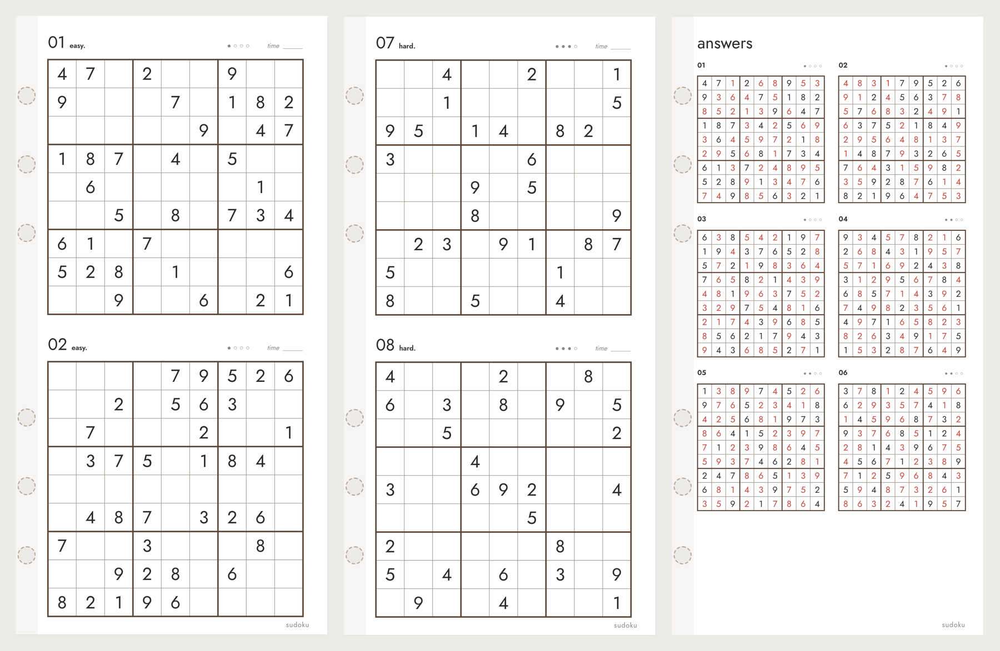

# Diary Sudoku Generator

[한국어](README.md) | **English**

A browser tool that makes sudoku inserts for ring-bound system diaries and saves them as PDF. Nothing to install.

**Open:** https://mov-ie.github.io/diary-sudoku-generator/

## What it makes

Inserts are 86×171mm by default, with one or two puzzles per page and answer pages at the back. Every time you open the page it generates new random puzzles, and each one is checked to have **exactly one solution**.

## Features

### Puzzles

- **Count:** 1 to 120 puzzles.
- **Difficulty:** easy, medium, hard, expert, or mix. With "mix" the puzzles get harder toward the end. Difficulty comes from the **solving techniques a puzzle needs**, not just from how many clues it has.

  | Level | Clues | What it takes |
  |---|---|---|
  | easy | 36–40 | Fill cells where only one digit fits |
  | medium | 29–32 | Find the only place a digit can go in a row, column or box |
  | hard | 24–31 | Eliminate candidates (pointing/claiming, naked pairs and triples, hidden pairs) |
  | expert | 24–30 | Still stuck after all of the above; needs deeper reasoning |

- **New puzzles:** each press of 새 퍼즐 만들기 (new puzzles) makes a different set.
- **Puzzle number:** every set has a number. Enter it again later to get exactly the same puzzles.
- **Answer pages:** six answers per page at the back. Given digits use the text color and solved digits use the answer color (red by default). Can be turned off.

### Layout and labels

- **One or two puzzles per page.** With one, choose a **vertical position**: top or centered.
- **Starting number:** start numbering anywhere, for example 13 to continue after a set that ended at 12. The answer pages follow.
- **Number style:** `1`, `01` or `no.1`.
- **Level label:** English (`easy.`), Korean (`쉬움`), or none.
- **Difficulty dots (●○○○), a time field, and a footer** (`sudoku` by default) can each be turned on or off.

### Colors and lines

- **Sizes:** number label size and digit size relative to the cell.
- **Colors:** lines (dark brown #5B4636 by default), text, answer digits, dots and footer.
- **Lines:** separate widths for thin cell lines and thick 3×3 lines, plus optional shading on alternate 3×3 boxes.

### Size and output

- **Insert size and margins:** width, height, ring-side margin, outer margin, top and bottom margin.
- **Paper:**
  - **Insert size:** one insert per PDF page at actual size.
  - **A4 / A3:** several inserts per sheet with crop marks. Choose auto, portrait or landscape, and set the printer's safe margin. 86×171mm fits 3 per A4 landscape sheet and 6 per A3 portrait sheet.
- **Single or double-sided:** see "Double-sided printing" below.
- **Preview:** shows the ring holes (6-ring bible layout) on screen only; they never print. Zoom is adjustable.

## How to use

1. Open the page.
2. In the left panel, choose the number of puzzles, difficulty and puzzles per page.
3. Press **새 퍼즐 만들기** until you like the set. Note its **puzzle number** if you want to keep it.
4. Adjust colors and margins. The preview updates as you go.
5. Press **PDF로 저장 / 인쇄** (save PDF / print) and choose **Save as PDF** in the print dialog. Set margins to "None" and scale to 100%. If the paper size isn't picked up, open the page in Chrome.

Your settings are saved in the browser and come back next time; the puzzles are new on every visit. **처음 설정으로 되돌리기** (reset) restores the defaults.

## Double-sided printing

With double-sided on, even pages are treated as backs and their ring margin moves to the other side (right), so the ring holes never cut into a puzzle on either side.

- **At insert size:** odd pages have the ring on the left, even pages on the right. Print with your printer's duplex setting as is.
- **On A4 / A3:** front and back sheets alternate. Each back sheet is mirrored left to right, so when the paper is turned over every page's back lands exactly behind its front. Turn on duplex and use the flip edge shown under the preview (**short edge** for landscape sheets, **long edge** for portrait).
- **Answer pages** always start on the front of a new leaf. If the puzzle pages come to an odd number, one blank page is added.

Example: 12 puzzles, two per page, A4 double-sided: 6 puzzle pages + 2 answer pages = 8 pages = 4 leaves. A4 landscape holds 3 leaves, so it prints on 2 sheets of A4, both sides.

## Files

- `index.html`: the whole editor, including the puzzle generator. You can download just this file and open it locally; it works the same.

## How the puzzles are made

1. Fill a complete 9×9 grid at random.
2. Remove digits in pairs mirrored around the center. After each removal, check the puzzle still has exactly one solution, and undo it if not.
3. Solve it the way a person would, record which techniques were needed, and keep only puzzles that match the chosen level.

The random numbers come from the puzzle number (seed), so the same number, count and level always give the same puzzles.
