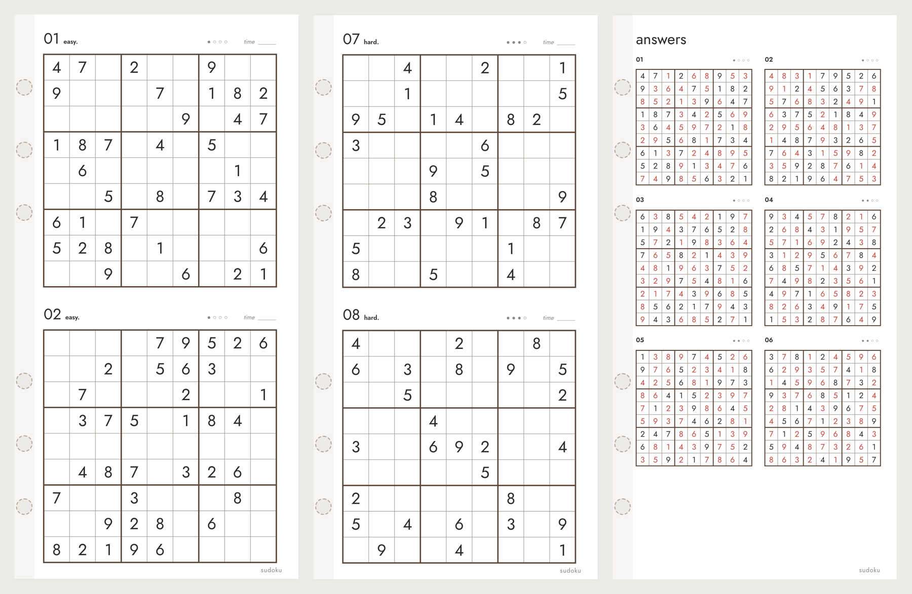

# Diary Sudoku Generator

**한국어** | [English](README.en.md)

시스템 다이어리용 스도쿠 속지를 만들어 PDF로 저장하는 편집 도구예요. 설치 없이 브라우저에서 바로 써요.

**바로 쓰기:** https://mov-ie.github.io/diary-sudoku-generator/

## 어떤 속지인가요

기본 크기는 86×171mm 속지예요. 한 쪽에 퍼즐을 1개나 2개 넣고, 맨 뒤에 해답 쪽을 붙여요. 페이지를 열 때마다 새 퍼즐이 랜덤으로 만들어지고, 모든 퍼즐은 **답이 하나뿐인지** 확인한 뒤에 넣어요.

## 할 수 있는 것

### 퍼즐

- **퍼즐 수:** 1~120개.
- **난이도:** 쉬움, 보통, 어려움, 최상, 섞기. '섞기'로 두면 앞에서 뒤로 갈수록 어려워져요. 난이도는 단서 개수가 아니라 **실제로 풀 때 필요한 기술**로 정해요.

  | 난이도 | 단서 수 | 푸는 방법 |
  |---|---|---|
  | 쉬움 | 36~40 | 칸 하나에 들어갈 숫자가 하나뿐인 곳을 차례로 채우면 풀려요 |
  | 보통 | 29~32 | 가로줄·세로줄·3×3 상자에서 숫자가 들어갈 자리가 한 곳뿐인 곳을 찾아야 해요 |
  | 어려움 | 24~31 | 후보 숫자를 지워 가며 풀어야 해요 (줄·상자 겹침, 짝·세 칸 묶음) |
  | 최상 | 24~30 | 위 방법으로도 막혀서 더 깊은 추론이 필요해요 |

- **새 퍼즐 만들기:** 누를 때마다 다른 퍼즐 묶음이 나와요.
- **퍼즐 번호:** 묶음마다 번호가 있어요. 번호를 적어 두었다가 다시 넣으면 똑같은 퍼즐이 나와요.
- **해답 쪽:** 맨 뒤에 한 쪽에 6개씩 붙어요. 원래 있던 숫자는 글자 색, 채워 넣은 숫자는 해답 색(기본 빨강)으로 보여요. '없음'으로 끌 수도 있어요.

### 배치와 표시

- **한 쪽에 1개 / 2개.** 1개일 때는 **세로 위치**를 위나 가운데로 골라요.
- **시작 번호:** 번호를 원하는 수부터 시작해요. 앞 묶음이 12번까지였다면 13으로 두면 이어서 번호가 붙어요. 해답 쪽 번호도 같이 바뀌어요.
- **번호 모양:** `1`, `01`, `no.1`.
- **난이도 이름:** `easy.`처럼 영어로, `쉬움`처럼 한글로, 또는 표시하지 않기.
- **난이도 점(●○○○), 시간 적는 칸, 쪽 아래 글씨**(기본 `sudoku`)를 켜고 끌 수 있어요.
- **퍼즐 번호 표시:** 쪽마다 왼쪽 아래에 그 묶음의 퍼즐 번호(예: `#20270101`)를 작게 찍어요. 인쇄한 속지만 있어도 같은 퍼즐을 다시 만들 수 있어요. 기본으로 켜져 있어요.

### 색, 선

- **크기:** 번호 글자 크기, 칸 대비 숫자 크기.
- **색:** 선 색(기본 다크 브라운 #5B4636), 글자 색, 해답 숫자 색, 점·아래 글씨 색.
- **선:** 가는 선과 3×3 굵은 선의 굵기를 따로 정해요. 3×3 상자에 번갈아 음영을 깔 수도 있어요.

### 크기와 출력

- **속지 크기와 여백:** 폭, 높이, 링 쪽 여백, 반대쪽 여백, 위아래 여백.
- **출력 용지:**
  - **속지 크기:** 속지 크기 그대로 한 쪽씩 저장해요.
  - **A4 / A3:** 한 장에 여러 쪽을 재단선과 함께 배치해요. 방향은 자동, 세로, 가로 중에서 고르고, 프린터 안전 여백을 정할 수 있어요. 86×171mm는 A4 가로에 3쪽, A3 세로에 6쪽이 들어가요.
- **단면 / 양면:** 아래 '양면 인쇄' 참고.
- **미리보기:** 링 구멍 위치(6공 바이블 규격)를 화면에만 표시해요. 인쇄에는 나오지 않아요. 확대 비율도 바꿀 수 있어요.

## 사용법

1. 페이지를 열어요.
2. 왼쪽 패널에서 퍼즐 수, 난이도, 한 쪽에 넣을 개수를 정해요.
3. 마음에 들 때까지 **새 퍼즐 만들기**를 눌러요. 남겨 두고 싶은 묶음은 **퍼즐 번호**를 적어 두세요.
4. 색, 여백을 원하는 대로 바꾸세요. 오른쪽 미리보기가 바로 바뀌어요.
5. 맨 아래 **PDF로 저장 / 인쇄**를 누르고, 인쇄 창에서 **PDF로 저장**을 고르세요. 여백은 '없음', 배율은 100%로 두세요. 용지 크기가 잡히지 않으면 Chrome으로 열어 주세요.

설정은 브라우저에 저장돼서 다음에 열어도 그대로예요. 퍼즐은 열 때마다 새로 만들어요. 처음 상태로 돌리려면 **처음 설정으로 되돌리기**를 누르세요.

## 양면 인쇄

양면으로 고르면 짝수 쪽을 뒷면으로 보고, 링 쪽 여백을 반대편(오른쪽)으로 옮겨요. 그래서 앞뒤 어느 쪽이든 링 구멍이 퍼즐을 가리지 않아요.

- **속지 크기로 저장할 때:** 홀수 쪽은 링이 왼쪽, 짝수 쪽은 링이 오른쪽이에요. 프린터의 양면 기능으로 그대로 출력하면 돼요.
- **A4 / A3에 배치할 때:** 앞면 장과 뒷면 장을 번갈아 만들어요. 뒷면 장은 좌우를 뒤집어 놓아서, 종이를 뒤집었을 때 각 쪽의 뒷면이 정확히 같은 자리에 와요. 프린터에서 양면을 켜고, 미리보기 아래 안내에 나오는 넘김 방향을 고르세요(가로 용지는 **짧은 쪽 넘기기**, 세로 용지는 **긴 쪽 넘기기**).
- **해답 쪽**은 언제나 새 낱장의 앞면에서 시작해요. 퍼즐 쪽 수가 홀수면 빈 쪽을 하나 넣어서 맞춰요.

예) 퍼즐 12개, 한 쪽에 2개, A4 양면: 퍼즐 6쪽 + 해답 2쪽 = 8쪽 = 낱장 4장. A4 가로 한 장에 낱장 3장이 들어가서 A4 2장(앞뒤)으로 출력돼요.

## 파일 구성

- `index.html`: 편집기 전체(퍼즐 생성기 포함). 이 파일 하나만 내려받아 PC에서 바로 열어도 똑같이 동작해요.

## 퍼즐을 만드는 방식

1. 숫자를 무작위로 넣어 완성된 9×9 판을 만들어요.
2. 가운데를 기준으로 마주 보는 두 칸씩 숫자를 지워요. 지울 때마다 답이 하나뿐인지 확인하고, 둘 이상이 되면 되돌려요.
3. 사람이 푸는 순서대로 풀어 보며 어떤 기술이 필요한지 따져서, 고른 난이도에 맞는 퍼즐만 남겨요.

난수는 퍼즐 번호(시드)에서 만들어지기 때문에, 같은 번호·퍼즐 수·난이도면 언제나 같은 퍼즐이 나와요.
